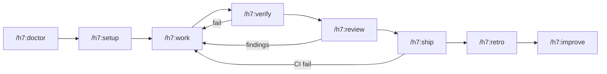

# Agents

[](https://github.com/H7KZ/Agents/actions/workflows/ci.yml) [](LICENSE)

`h7` is a universal, cross-repo agent workflow for Claude Code, shipped as a plugin from the `h7kz` marketplace
(this repo). It invests in the agent's environment (guards, checks, verification) instead of reading every diff.

Design and decisions: [docs/design.md](docs/design.md), [docs/adr/](docs/adr/README.md).

## Install

Requires Node 22.18+, git and the Claude Code CLI. The bootstrap adds the `h7kz` marketplace with auto-update,
installs `h7` and `mattpocock-skills` (from `claude-plugins-official`), creates `~/.h7`, and offers to remove
stale duplicate mattpocock copies (it lists them and asks first; `--yes` skips the question).

```powershell
# Windows (PowerShell)
git clone https://github.com/H7KZ/Agents.git; powershell -ExecutionPolicy Bypass -File Agents\bootstrap\install.ps1
```

```sh
# macOS / Linux
git clone https://github.com/H7KZ/Agents.git && sh Agents/bootstrap/install.sh
```

Options: `--dry-run` (print only), `--dev <repo>` (authoring machine, live edits, see below), `--local <path>` (add the
marketplace from a local clone; a copy, not live), `--yes`. It is idempotent and copies the original
`~/.claude/settings.json` to `settings.json.h7bak` (once, before any `claude` command touches it). It adds
`claude-plugins-official` first when that marketplace is unknown, since `mattpocock-skills` comes from there.

### Authoring machine: live edits

A directory marketplace (`--local`) does NOT give live edits: Claude Code copies the plugin into its cache
(`plugins/cache/h7kz/h7/<sha>`). Use `--dev <repo>` instead. It links `<repo>/plugins/h7` into `~/.claude/skills/h7`
(a directory junction on Windows, no admin needed), which Claude Code loads in place as `h7@skills-dir`. No marketplace is
added for h7 and `h7@h7kz` is uninstalled, otherwise h7 and its hook would load twice. Run `/reload-plugins` after edits.
Evidence: [ADR 0003](docs/adr/0003-sync-marketplace-plugin.md). `/h7:doctor` reports which mode is active and fails if both are.

Without the bootstrap: `claude plugin marketplace add H7KZ/Agents` then `claude plugin install h7@h7kz`. A plain `marketplace add` leaves `autoUpdate` off, so `/h7:doctor` fails the `auto-update` check until you set `extraKnownMarketplaces.h7kz.autoUpdate` to `true` in `~/.claude/settings.json` (the bootstrap does this).

### Workspace mode (team repos)

When h7 is only your personal workflow and the repos belong to a team, nothing of h7 may land in them. Put a `.h7-workspace.json` in a folder above the repos (inside your home, owned by you, not writable by others):

```json
{ "version": 1, "stateDir": ".h7", "scratch": "tmp",
  "repos": { "web": { "base": "develop", "verification": "docs/agents/verification-web.md", "prTemplate": "docs/pull-requests.md", "ship": "pr", "autoMerge": false } },
  "memory": { "agents": "AGENTS.md", "glossary": "GLOSSARY.md", "adr": "docs/adr" } }
```

Then journals, verify and review state and CI watcher state live in `<workspace>/.h7/<repo>/`, setup writes only under the workspace (no branch, no commits in the repo), ship reads its settings from the workspace and follows `prTemplate`, and the coverage baseline is built from `git archive` in the OS temp dir. The marker can set a `scratch` dir, push and auto-merge, so those count only after you run `node <plugin>/scripts/workspace.ts trust` in a terminal (it shows the file and needs a typed yes; the hash is kept in an owner-only file under your `.h7` home folder). On Windows the owner cannot be checked, so the typed-yes hash is the only anchor there. `/h7:doctor` validates the marker and reports its trust state. Design: [docs/design.md](docs/design.md).

## Commands

| Command | What it does |
|---|---|
| `/h7:doctor` | Read-only check of this machine: Node, git, gh (+auth), claude, marketplace and auto-update, mattpocock skills and duplicates, `~/.h7` |
| `/h7:setup` | Once per repo: interview the repo, write `docs/agents/verification.md`, the AGENTS.md block, and proven `verify-*` skills |
| `/h7:verify` | Run the testing bar scoped to the change (diff coverage, mutation, edge cases, e2e); records `.h7/verify.json` |
| `/h7:review` | Fresh-context lens reviewers (spec, standards, adversarial, security, performance, test quality, architecture); only reproduced findings survive |
| `/h7:ship` | Commit story, PR body, CI watcher (READY / WAITING / BLOCKED); never merges unless the repo opts in |
| `/h7:work` | Driver: research, grill, implement, verify, review, loop, ship, with a run journal in `.h7/runs` |
| `/h7:retro` | Turn corrections into proposed checks; you approve row by row |
| `/h7:improve` | Work the improvement queue in `~/.h7/proposals` |
| `/h7:formal-create`, `/h7:formal-maintain` | Opt-in TLA+/statechart models and drift checks |

Full reference, workflow diagram and recommended workflows: **[docs/guide.md](docs/guide.md)**.



All skills are user-invoked only (`disable-model-invocation: true`); nothing auto-triggers. Run `/h7:setup` in a repo
before `/h7:work`. Runner minutes: CI runs 3 cells; run `npm run mutation` locally before merging.

## Always-on safety guard

A `PreToolUse` hook for Bash and PowerShell. It blocks force pushes to protected branches, hook skipping
(`--no-verify`, `HUSKY=0`), committing secrets and recursive deletes outside the
repo; it asks before protected pushes and deploy/publish commands. Near-misses are logged (secrets redacted) to
`~/.h7/guard.log`. Internal errors ask instead of allowing. `H7_GUARD=off` disables it.

**Prompts follow your session.** In a `bypassPermissions` session the guard does not add its own prompts: things it
would only ask about run (and are still logged); hard blocks (force push to protected branches, hook skipping,
secret commits, deletes outside the repo) always block. In every other mode it asks.
Override per machine with `H7_GUARD_ASK=prompt|allow|deny` or `{"ask": "..."}` in `~/.h7/guard.json` (your explicit
choice always wins over the session mode).

**Destructive git on a dirty tree is snapshotted, then allowed** (every mode). `reset --hard`, `checkout -- .`, `restore`, `clean` and friends first save tracked changes plus untracked non-ignored files as a commit on `refs/h7/backup/<UTC time>-<n>` (temporary index; your worktree and index are untouched; last 20 kept) and print the ref with `git restore --source=<ref> --worktree -- .`. If the snapshot fails, or `clean -x` would delete ignored files, the command stays blocked.

**Unattended runs** (`/h7:work` started with `--unattended`, or `H7_UNATTENDED=1`): the guard turns would-be prompts into an immediate deny ("park it, journal it, continue with other work") so a run never stalls on a human. Stricter only: your explicit ask mode (`allow`/`deny`), bypass-derived allow and hard blocks are never changed, and a later `start` cannot drop the flag. Things that need a human are recorded with `run-journal.ts park` and reported at the end (PushNotification when available) with the resume command.

It is a safety floor against agent accidents, not a sandbox: anything it cannot resolve statically asks
(git failing or missing, piping into a shell, `xargs`, `iex`, variable command words or delete targets, git aliases,
`find -delete` and `xargs rm` starts), and only clearly destructive, resolvable cases are blocked. State carries across a
chain (`git checkout main && git push -f`, `git stash -u && git reset --hard`, `cd` outside a subshell). Secret files are
tiered: `.env`, `id_rsa`, `*.key`, `*.p12` and similar block; `.env.development`, `*.pem`, `.npmrc`, `*.tfvars` ask
(a `*.pem` holding a private key blocks). Deletes under the OS temp directory are allowed.

## Privacy and security

No telemetry, no network calls from the plugin scripts. Logs, run journals and proposals stay on your machine
(`~/.h7`, `.h7/` in the repo, git-excluded), with secrets redacted before writing. Repository content is treated
as data, never as instructions. See [SECURITY.md](SECURITY.md) for the threat model, known limits and how to
report a vulnerability.

## Status and support

Early but tested: 100% line/branch/function coverage, mutation score above 80, CI on Linux and Windows (Node 22.18
and 24), macOS checked by hand. The plugin has no version number; the commit SHA is the version (`main` is the
supported line). The LLM-driven skills are verified by lint, static tests and their helper scripts, so expect rough
edges and please file issues. Windows, macOS, Linux and WSL are supported.

## Contributing

See [CONTRIBUTING.md](CONTRIBUTING.md) and [AGENTS.md](AGENTS.md). `npm ci && npm run check`. Please follow the
[code of conduct](CODE_OF_CONDUCT.md).

License: MIT. Attribution: [NOTICE](NOTICE).
