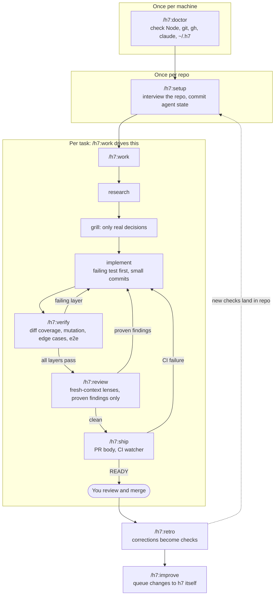

# h7 guide

How to get the most out of h7. Reference for every command, how they fit together, and the workflows that work best.

## The idea in one minute

You do not read every diff. You invest in the agent's environment so a bad change cannot slip through:

1. **Guard** (always on) stops accidents: force pushes, hook skipping, secrets, deletes outside the repo.
2. **Setup** (once per repo) teaches h7 how this repo is checked: commands, surfaces, how to run it.
3. **Work** (per task) runs a loop: plan with you, implement test-first, **verify**, **review**, repeat until the done predicate holds, then **ship**.
4. **Retro / improve** (weekly) turns every correction you made into a permanent check.

Everything is user-invoked (`/h7:<name>`). Nothing auto-triggers, so you always know what is running.

## Workflow at a glance

The loop stops itself after **5 non-improving rounds** and reports instead of grinding. The done predicate is never relaxed to make it pass.

## What each command does

| Command | Use it when | You get | Writes |
|---|---|---|---|
| `/h7:doctor` | New machine, or h7 behaves oddly | Read-only report with a suggested fix per failure | nothing |
| `/h7:setup` | First time in a repo, or the repo's tooling changed | `docs/agents/verification.md`, an h7 block in `AGENTS.md`, `CLAUDE.md` importing `AGENTS.md`, proven `verify-<surface>` skills with feature maps | repo files (committed) |
| `/h7:verify` | Any time you want the testing bar run on your change | Per-layer pass/fail with evidence; diff coverage 100% line+branch with no global drop, mutation at least 80% on changed files, edge-case matrix, property tests, e2e through the repo's verify skill, failing-first regression test per bug. Asks before installing missing tools | `.h7/verify.json` (git-excluded) |
| `/h7:review` | Before ship, or as a second opinion on any branch | Seven fresh-context reviewers (spec, standards, adversarial, security, performance, test-quality, architecture). Lenses are picked by change type and skipped ones are logged. Only findings with a reproducing command and output survive. Commands outside a read-only allowlist ask you first | `.h7/review/` (git-excluded) |
| `/h7:ship` | Change is verified and reviewed | Small Conventional Commits that each pass the repo check, a PR (or push, per the repo's ship mode) with Why / What / Scope / Blast radius / Verification / Review / Decisions, and a CI watcher verdict READY / WAITING / BLOCKED. Flaky job: one rerun. Real failure: log excerpt for a fix loop. Never merges unless the repo opts in | git, PR |
| `/h7:work` | A task you want done end to end | The whole loop above, with a run journal | `.h7/runs/<id>/journal.jsonl` (git-excluded) |
| `/h7:retro` | After a run, or weekly | Your corrections turned into proposed rows (rule + enforcer). You approve row by row; approved rows are written to the rule table | `AGENTS.md` table rows you approved |
| `/h7:improve` | You have an idea for h7 itself | A queue of proposals in `~/.h7/proposals`; you accept or reject; accepted ones become branches only when you ask | `~/.h7/proposals/` |
| `/h7:formal-create` | A stateful component tests rarely reach (concurrency, ordering, sync) | A TLA+ model with checker commands and a statechart; installs tools only after asking | `docs/formal/<name>/` |
| `/h7:formal-maintain` | Code changed under a modelled component | Drift report per model; reruns checks after you approve the command | model `sync` stamp |

## Where state lives

| Path | What | Committed |
|---|---|---|
| `AGENTS.md` (h7 block) | Rules and the rule-to-enforcer table; `CLAUDE.md` just imports it | yes |
| `docs/agents/verification.md` | How to check this repo, ship mode, auto-merge opt-in | yes |
| `.claude/skills/verify-*` | Repo-specific e2e skills with feature maps | yes |
| `docs/formal/` | Formal models | yes |
| `.h7/` | Run journals, verify and review state, CI watcher state | no (added to `.git/info/exclude`) |
| `~/.h7/` | Guard log, guard ask-mode config, models.json, proposals | no (per machine, owner-only) |

## Best workflows

**First day in a repo.** `/h7:doctor` once per machine, then `/h7:setup`. Read what it wrote; fix anything that is wrong. This is the highest-leverage ten minutes: every later command reads it.

**Normal feature or fix (default).** `/h7:work <task>`. Answer the grill questions (they are only real decisions), then let it run. Come back to a PR with evidence. Skim the PR body, not the diff.

**Small obvious change.** Edit yourself, then `/h7:verify`, then `/h7:ship`. Skip `/h7:work` when there is nothing to research or decide.

**Second opinion on any branch.** `/h7:review` alone. Good for colleagues' PRs or your own manual work.

**Babysit a PR.** `/h7:ship` ends by running the CI watcher. To check an open PR yourself, run `node ${CLAUDE_PLUGIN_ROOT}/scripts/ci-watch.ts` (or the plugin's path) in the repo: it reruns one flake per head commit, flags a stale base, and returns the failing log excerpt when a failure is real.

**Weekly (10 minutes).** `/h7:retro` on the week's runs. Approve only rows that name a real enforcer (a test, lint rule or hook). Then `/h7:improve` for anything that belongs in h7 itself. Over time your corrections turn into checks and you correct less.

**Hard-to-test stateful code.** `/h7:formal-create` once for that component, `/h7:formal-maintain` when it changes. Opt-in; do not model everything.

## Tips that matter

- **Keep `AGENTS.md` short** (h7's own is under 150 lines). Prose the agent must remember is weaker than a check it cannot skip.
- **Prefer a different reviewer model than the author.** Put it in `~/.h7/models.json`; `/h7:review` refuses a same-family reviewer. Optional: codex or gemini CLI if installed (asked first).
- **Let it stop.** After 5 non-improving rounds `/h7:work` reports instead of looping. Read the report; usually a decision is missing.
- **Trust evidence, not summaries.** The journal and `.h7/verify.json` hold the commands and outputs.
- **One task per `/h7:work` run.** Big goals: split first, each part gets its own verify and ship.

## Safety guard cheat sheet

| Situation | Result |
|---|---|
| Force push to protected branch, delete it, `--no-verify` / `HUSKY=0`, `core.hooksPath` outside the repo | blocked |
| `git reset --hard`, `checkout -- .`, `clean` on a dirty tree | blocked until you commit or stash |
| Commit with high-confidence secrets (`.env`, `id_rsa`, `*.key`, `.pem` with a private key) | blocked |
| Recursive delete outside the repo, `rm -rf .git` | blocked |
| Protected push, deploy or publish, history rewrite, unresolved targets, shell fed from a pipe, `xargs`, git aliases | asks |
| Anything inside the OS temp dir | allowed |

Tips: run single plain commands (long `&&` chains and `node -e` ask). Ask mode is per machine (`prompt`, `allow`, `deny`) in an owner-only config under `~/.h7`; agents cannot edit it. Hard blocks never weaken. `H7_GUARD=off` is the only escape hatch; use it consciously. It is an accident floor, not a sandbox.

## Troubleshooting

| Symptom | Fix |
|---|---|
| h7 hook loads twice, or skills duplicated | `/h7:doctor` (reports dev vs marketplace mode, fails if both) |
| `/h7:verify` says tooling missing | It asks before installing; approve, or point it at your existing tool in `docs/agents/verification.md` |
| `/h7:work` stuck, says non-improving | Read the report; answer the open decision or split the task |
| `/h7:ship` BLOCKED `status-query` | No PR yet, or `gh` missing / not logged in (`gh auth login`) |
| Guard asked about something harmless | Run it as one plain command, or set ask mode on this machine |
| Scope looks wrong | `node plugins/h7/scripts/verify-scope.ts --base <ref>` shows exactly what h7 thinks changed |
